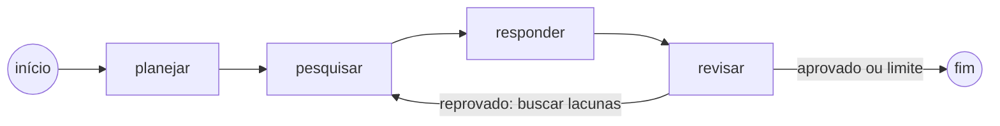

# Agente Pesquisador 🔎

Agente de pesquisa de mercado construído com **LangGraph**, **Gemini** e observabilidade com **Langfuse**.
Projeto de estudo em público: a cada etapa eu documento o que aprendi, o que quebrou e os números.

## Problema de negócio
Analisar um concorrente ou mercado leva horas de um analista: buscar, ler, cruzar e resumir.
O objetivo é um agente que entregue um relatório com fontes em minutos — e que **meça a própria qualidade**.

## Arquitetura (dia 3)


## Roadmap
- [x] Dia 1 — grafo simples com estado + tracing no Langfuse
- [x] Dia 2 — busca na web (Tavily) e relatório com fontes citadas [n]
- [x] Dia 3 — nó revisor com saída estruturada + aresta condicional (loop de melhoria com limite)
- [ ] Evals: dataset de perguntas + LLM-as-judge
- [ ] API com FastAPI + Docker

## Como rodar
```bash
cp .env.example .env    # preencha as chaves
uv sync
uv run main.py "Como está o mercado de energia solar residencial no Brasil?"
```

## Aprendizados
- **Dia 1:** modelos são descontinuados rápido (nome do modelo vai no `.env`); APIs falham (retries + fallback); retries demais viram latência — o Langfuse mostrou o fallback levando ~2 min.
- **Dia 2:** sem fontes, o modelo responde com a "memória" e pode inventar números. Com busca + regra de citar [n], cada afirmação fica verificável.
- **Dia 3:** um fluxo vira *agente* quando ele decide o próximo passo (aresta condicional). Saída estruturada (Pydantic) deixa o código ler a decisão do LLM com segurança. Todo loop precisa de freio (`MAX_REVISOES`).
