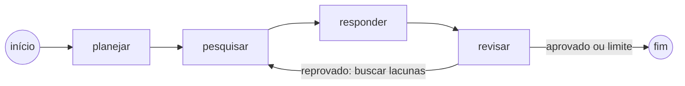

# Agente Pesquisador 🔎

Agente de pesquisa de mercado construído com **LangGraph**, **Gemini** e observabilidade com **Langfuse**.
Projeto de estudo em público: a cada etapa eu documento o que aprendi, o que quebrou e os números.

## Problema de negócio
Analisar um concorrente ou mercado leva horas de um analista: buscar, ler, cruzar e resumir.
O objetivo é um agente que entregue um relatório com fontes em minutos — e que **meça a própria qualidade**.

## Arquitetura (dia 3)


## Roadmap
- [x] Dia 1 — grafo simples com estado + tracing no Langfuse
- [x] Dia 2 — busca na web (Tavily) e relatório com fontes citadas [n]
- [x] Dia 3 — nó revisor com saída estruturada + aresta condicional (loop de melhoria com limite)
- [x] Dia 4 — evals: 6 perguntas de teste (incluindo pegadinha), checagens automáticas e juiz independente (LLM-as-judge)

## Como rodar
```bash
cp .env.example .env    # preencha as chaves
uv sync
uv run main.py "Como está o mercado de energia solar residencial no Brasil?"
```

## Como rodar os evals
```bash
uv run python -m evals.rodar            # bateria completa
uv run python -m evals.rodar --limite 2 # teste rápido
```
Resultados ficam em `evals/resultados/` (um CSV por execução, para comparar versões).

## Aprendizados
- **Dia 1:** modelos são descontinuados rápido (nome do modelo vai no `.env`); APIs falham (retries + fallback); retries demais viram latência — o Langfuse mostrou o fallback levando ~2 min.
- **Dia 2:** sem fontes, o modelo responde com a "memória" e pode inventar números. Com busca + regra de citar [n], cada afirmação fica verificável.
- **Dia 3:** um fluxo vira *agente* quando ele decide o próximo passo (aresta condicional). Saída estruturada (Pydantic) deixa o código ler a decisão do LLM com segurança. Todo loop precisa de freio (`MAX_REVISOES`).
- **Dia 4:** evals encontram o que um teste por vez não mostra. A pergunta-pegadinha (empresa inexistente) revelou que o revisor *punia* a resposta honesta "não encontrei" e gastava 2 rodadas extras de busca. Corrigido: agora aprova o "não encontrei" honesto e para quando a busca não traz fonte nova. Também aprendi que o juiz precisa ser um modelo diferente do avaliado (senão é o aluno corrigindo a própria prova).

## Resultados dos evals (19/11/2026)
| Métrica | Antes das correções | Depois |
|---|---|---|
| Pegadinha | 3 rodadas, revisor deu 2 → 0 → 0 | 1 rodada, aprovada ✅ |
| Tempo médio por pergunta | ~9 min (548 s, com o modelo principal falhando e caindo no fallback) | ~28 s |
| Revisor × juiz independente | — | 10 × 9,5 (concordam) |
| Citações inválidas | — | 0 |

## Próximos passos
- [ ] Dia 5 — tool calling nativo: o próprio LLM decide quando e o que pesquisar
- [ ] Dia 6 — servidor MCP: o agente vira ferramenta para outras IAs (ex.: Claude)
- [ ] Dia 7 — API com FastAPI + Docker
